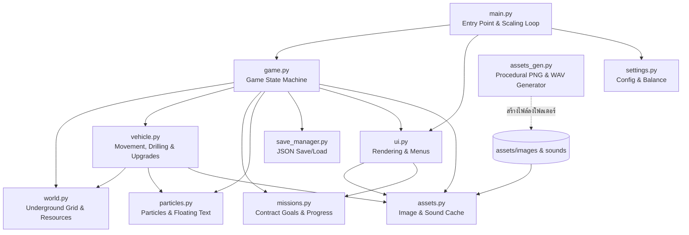

# เอกสารอธิบายสถาปัตยกรรมและระบบภายในเกม Dig & Treasure (ขุดดินหาสมบัติ)

เอกสารฉบับนี้สรุปโครงสร้างสถาปัตยกรรม ระบบย่อย กลไกเกมเพลย์ และอัลกอริทึมทั้งหมดของโปรเจกต์ **`MidtermProject` (Dig & Treasure)** ซึ่งพัฒนาด้วยภาษา **Python** และไลบรารี **Pygame**

---

## 1. ภาพรวมโปรเจกต์ (Project Overview)

**Dig & Treasure (ขุดดินหาสมบัติ)** เป็นเกมแอ็กชันขุดเหมืองและบริหารจัดการทรัพยากร (2D Mining & Resource Management Game) ที่ผู้เล่นบังคับรถขุดเจาะลงไปใต้ผืนดินเพื่อค้นหาแร่มีค่า (เหรียญแร่, ทองคำ, เพชรพลอย และกระป๋องน้ำมัน) นำกลับมาขายเพื่อสะสมเงินทุน อัปเกรดประสิทธิภาพรถขุด ปรับแต่งตัวถังและหัวขุดในอู่ (Garage) และพิชิตเป้าหมายในโหมดสัญญาภารกิจ หรือดำดิ่งปลดล็อคชั้นความลึกแบบไร้ขีดจำกัดในโหมดคลาสสิก

### จุดเด่นทางวิศวกรรมซอฟต์แวร์ของโปรเจกต์
1. **Modular Architecture**: แยกส่วนรับผิดชอบ (Separation of Concerns) ออกเป็นโมดูลชัดเจน ได้แก่ ลูปหน้าจอ (`main.py`), ค่าคงที่ (`settings.py`), ลอจิกสถานะเกม (`game.py`), แผนที่ใต้ดิน (`world.py`), รถขุดและฟิสิกส์ (`vehicle.py`), ระบบภารกิจ (`missions.py`), กราฟิกและ UI (`ui.py`), ระบบอนุภาค (`particles.py`), ระบบจัดการไฟล์เซฟ (`save_manager.py`), และระบบจัดการ Assets (`assets.py`, `assets_gen.py`)
2. **Self-Contained Procedural Assets**: มีสคริปต์ `assets_gen.py` ที่ใช้ไลบรารี `Pillow (PIL)` วาดสไปรต์/พื้นผิวทั้งหมด และใช้สมการคลื่นคณิตศาสตร์สังเคราะห์เสียงเอฟเฟกต์ `.wav` ทั้งหมดขึ้นเองโดยไม่ต้องพึ่งพาไฟล์ภายนอก
3. **Resolution-Independent Scaling**: วาดกราฟิกทั้งหมดลงบน Virtual Surface ขนาดคงที่ (`720 × 810` พิกเซล) แล้วคำนวณอัตราส่วนขยาย (Letterbox / Pillarbox) พร้อมแปลงพิกัดเมาส์กลับอัตโนมัติเมื่อย่อ/ขยายหน้าต่างหรือสลับโหมดเต็มจอ (Fullscreen)
4. **Automated Headless Testing**: มีชุดทดสอบ `test_game.py` ที่รันจำลองเกมเพลย์และตรวจเช็กลอจิกทุกระบบแบบไม่ต้องเปิดหน้าต่างจริง (`SDL_VIDEODRIVER="dummy"`)

---

## 2. โครงสร้างไฟล์และหน้าที่ของแต่ละโมดูล (Project Structure)

```text
MidtermProject/
├── main.py               # จุดเริ่มต้นโปรแกรม (Entry Point), Game Loop 60 FPS, ระบบ Fullscreen & Scaling
├── settings.py           # ค่าคงที่ทั้งหมดของเกม (ขนาดกริด, สี, ค่าสมดุลแร่, สเตตัสรถ, ราคาอัปเกรด, ชั้นความลึก)
├── game.py               # คลาส Game (State Machine หลัก), การจัดการ Input, กล้อง, ระบบร้านค้า/อู่แต่งรถ/ปลดล็อคชั้น
├── world.py              # คลาส World, การสุ่มสร้างแผนที่ใต้ดิน (Procedural Grid), HP บล็อก, แร่ และประตูกั้นชั้น
├── vehicle.py            # คลาส Vehicle, ฟิสิกส์การเคลื่อนที่, การเจาะบล็อก, พลังงานศักย์/เทอร์โบ, ระบบอัปเกรด
├── missions.py           # คลาส Mission และคลังภารกิจผสม 3 ระดับความยาก (ง่าย, ปานกลาง, ยาก)
├── ui.py                 # การวาดกราฟิกฉากหลัง, บล็อก, รถขุด, HUD 3 โซน, และหน้าต่างเมนูทุกสถานะ
├── particles.py          # คลาส ParticleSystem, Particle, FloatingText สำหรับเอฟเฟกต์เศษดิน ประกายไฟ และข้อความลอย
├── assets.py             # ระบบโหลดและแคชรูปภาพ (pygame.Surface) และเสียง (pygame.mixer.Sound) พร้อม Cooldown
├── assets_gen.py         # สคริปต์สร้างภาพ PNG และสังเคราะห์เสียง WAV ทั้งหมดขึ้นโดยอัตโนมัติ
├── save_manager.py       # ระบบบันทึก/โหลด/ลบข้อมูลเซฟเกมในรูปแบบไฟล์ JSON (savegame.json)
├── test_game.py          # ชุดทดสอบอัตโนมัติ (Unit & Integration Tests) ตรวจสอบการทำงานของเกมครบวงจร
├── requirements.txt      # รายการไลบรารีที่ใช้ (pygame>=2.5.0)
└── assets/               # โฟลเดอร์เก็บไฟล์ที่สร้างจาก assets_gen.py
    ├── images/           # สไปรต์บล็อก, แร่, รอยแตก, อาคาร, ตัวถังรถ (16 แบบ), หัวขุด (20 แบบ)
    └── sounds/           # ไฟล์เสียงสังเคราะห์ 11 ไฟล์ (.wav)
```

### แผนผังความสัมพันธ์ระหว่างโมดูล (Architecture Diagram)




---

## 3. รายละเอียดระบบหลักภายในเกม (Core Systems Breakdown)

### 3.1 ระบบหน้าจอ การย่อขยาย และลูปหลัก (`main.py` & `settings.py`)
* **ขนาดหน้าจอมาตรฐาน (Virtual Canvas)**:
  * ขนาด 1 ช่องกริด (`TILE`) = `48 × 48` พิกเซล
  * ความกว้างโลก (`COLS`) = `15` คอลัมน์ $\rightarrow$ ความกว้างหน้าจอ (`SCREEN_W`) = `720` พิกเซล
  * ความสูงแถบข้อมูลด้านบน (`HUD_H`) = `90` พิกเซล
  * ความสูงหน้าจอรวม (`SCREEN_H`) = `720 + 90 = 810` พิกเซล
* **ระบบ Scaling & Letterboxing**:
  * เกมวาดทุกอย่างลงบน `game_surf` ขนาด `720 × 810` เสมอ
  * ฟังก์ชัน `compute_scale_and_offset()` คำนวณอัตราส่วน `scale = min(screen_w / game_w, screen_h / game_h)` เพื่อขยายภาพด้วย `pygame.transform.smoothscale()` โดยรักษาสัดส่วนภาพเดิมไม่ให้บิดเบี้ยว
  * เมื่อผู้เล่นคลิกเมาส์ ฟังก์ชัน `Game.screen_to_game_pos()` จะแปลงพิกัดเมาส์จากหน้าจอจริงกลับมาเป็นพิกัดบน `game_surf` อัตโนมัติ
* **การควบคุม Delta Time (`dt`)**:
  * ล็อกเฟรมเรตที่ `60 FPS` และจำกัดค่า `dt = min(dt, 0.05)` เพื่อป้องกันกรณีเฟรมกระตุกแล้วรถขุดเคลื่อนที่ทะลุบล็อกในเฟรมเดียว (Tunneling Prevention)

---

### 3.2 ระบบจัดการสถานะเกม — State Machine (`game.py`)
คลาส `Game` ควบคุมการไหลของหน้าจอทั้งหมดผ่านตัวแปร `self.state` ซึ่งมีทั้งหมด **9 สถานะ**:

| สถานะ (State) | ค่าคงที่ | หน้าที่และการทำงาน |
| :--- | :--- | :--- |
| **เมนูหลัก** | `MENU` | หน้าแรกของเกม เลือกโหมดคลาสสิก, โหมดภารกิจ, โหลดเซฟ, ดูวิธีเล่น หรือออกจากเกม |
| **เลือกสัญญาภารกิจ** | `CONTRACT` | แสดงการ์ดภารกิจสุ่ม 3 ระดับ (ง่าย, ปานกลาง, ยาก) ให้เลือกก่อนเริ่มรอบ หรือกดสุ่มใหม่ |
| **กำลังเล่น** | `PLAYING` | อัปเดตตำแหน่งรถขุด, การขุดเจาะ, พลังงาน, อนุภาค, กล้องติดตามรถขุด และการตรวจเงื่อนไขชนะ/แพ้ |
| **หยุดชั่วคราว** | `PAUSED` | หยุดเวลาชั่วคราวเมื่อกด `ESC` มีปุ่มเล่นต่อ, คู่มือวิธีเล่น, สลับเต็มจอ, เปิด/ปิดเสียง, เซฟแล้วออก |
| **ร้านค้าอัปเกรด** | `SHOP` | เปิดเมื่อจอดหน้าร้านบนผิวดินแล้วกด `E` มี 3 แท็บ: อัปเกรดสเตตัส, อู่แต่งรถ, และปลดล็อคชั้น |
| **อู่แต่งรถขุด** | `GARAGE` | เข้าผ่านร้านค้าบนผิวดิน เพื่อปลดล็อคและติดตั้งสีรถ (8 สี), ตัวถัง (4 แบบ), และหัวขุด (5 แบบ) ด้วยเงื่อนไขความก้าวหน้า + เหรียญ |
| **วิธีเล่น & ปุ่มควบคุม** | `HOW_TO_PLAY` | หน้าต่างคู่มืออธิบายการบังคับ เทอร์โบ ร้านค้า อู่แต่งรถ และระบบเกม (กด `H` หรือ `F1` เปิดได้ทุกเมื่อ) |
| **จบเกม (แพ้)** | `GAME_OVER` | แสดงเมื่อพลังงานหมดกลางทางนอกฐานบ้าน (ในโหมดภารกิจ) พร้อมสรุปสถิติ |
| **ชนะภารกิจ** | `VICTORY` | แสดงเมื่อทำภารกิจครบทุกข้อและขับรถกลับถึงบ้านในโหมดภารกิจ |

---

### 3.3 ระบบโหมดการเล่นทั้ง 2 โหมด (`game.py`, `missions.py`, `settings.py`)

#### 1) โหมดสัญญาภารกิจ (Mission Contracts Mode)
* จัดการโดยโมดูล `missions.py` มีคลังภารกิจ (`MISSION_POOL`) ทั้งหมด **12 สัญญาภารกิจ** แบ่งเป็น 3 ระดับความยาก:
  * **ระดับง่าย (Easy)**: *มือใหม่หัดขุด*, *สำรวจชั้นตื้น*, *ช่างสว่านฝึกหัด*, *พ่อค้าแร่รุ่นเยาว์*
  * **ระดับปานกลาง (Medium)**: *นักล่าอัญมณีใต้พิภพ*, *ผู้พิชิตชั้นหิน*, *วิศวกรเครื่องจักรยักษ์*, *นักสำรวจพลังงาน*
  * **ระดับยาก (Hard)**: *ราชันย์เหมืองอเวจี*, *จักรกลสว่านสะท้านดิน*, *จ้าวแห่งแรงโน้มถ่วง*, *มหาเศรษฐีใต้พิภพ*
* **ระบบเป้าหมายผสม (Composite AND Goals)**:
  * แต่ละภารกิจมีเป้าหมายย่อย 3 ข้อผสมกันจากตัวชี้วัด 8 ชนิด ได้แก่ `diamonds` (เพชรที่ขุดได้), `gold` (ทองคำที่ขุดได้), `fuel` (กระป๋องน้ำมันที่เก็บได้), `depth` (ความลึกสูงสุด), `drill_lv` (เลเวลหัวขุด), `tier` (ระดับ Tier รวมของรถขุด), `coins` (เหรียญสูงสุดที่ถือครอง), และ `dives` (จำนวนครั้งที่พุ่งดิ่งกระแทก)
  * **เงื่อนไขชนะ**: เมื่อ `mission.is_completed()` เป็น `True` (ผ่านครบทุกข้อ) และผู้เล่นบังคับรถกลับมาเข้าเขตบ้าน (`home_zone`) เกมจะเปลี่ยนเข้าสู่สถานะ `VICTORY`

#### 2) โหมดคลาสสิกไร้ขีดจำกัด (Classic Endless Mode)
* ออกแบบให้เล่นได้ต่อเนื่องไม่มีตัดจบเกมอัตโนมัติเมื่อพลังงานหมด (เมื่อพลังงานหมด หน่วยกู้ภัยจะลากรถกลับฐานบ้านบนพื้นผิวและเติมพลังงานให้อัตโนมัติ)
* **ระบบชั้นความลึกและประตูกั้น (`CLASSIC_FLOORS` & Security Barriers)**:
  * แบ่งโลกใต้ดินออกเป็นชั้นๆ กั้นด้วยบล็อกประตูกั้นนิรภัย (`T_BARRIER`) ที่มีความทนทาน `999,999` (เจาะทำลายไม่ได้ ต้องใช้เหรียญปลดล็อค)
  * รายละเอียดชั้นความลึกใน `settings.py`:
    * **ชั้น 1: ผิวดิน & แร่อ่อน (Upper Crust)** — ความลึก `0–20 ม.` (ปลดล็อคฟรีตั้งแต่เริ่ม)
    * **ชั้น 2: หินแกรนิต & สายแร่ทอง (Granite Depths)** — ความลึก `21–45 ม.` (ค่าปลดล็อค `80` เหรียญ)
    * **ชั้น 3: หุบเหวคริสตัล & อัญมณี (Crystal Caverns)** — ความลึก `46–75 ม.` (ค่าปลดล็อค `220` เหรียญ)
    * **ชั้น 4: ลาวาใต้พิภพ & เพชรบริสุทธิ์ (Magma Bedrock)** — ความลึก `76–110 ม.` (ค่าปลดล็อค `500` เหรียญ)
    * **ชั้น 5: แกนพิภพลี้ลับ (Core Abyss)** — ความลึก `111–150 ม.` (ค่าปลดล็อค `1,000` เหรียญ)
    * **ชั้น 6: มิติใต้พิภพไร้สิ้นสุด (Infinite Depths)** — ความลึก `151–200 ม.` (ค่าปลดล็อค `1,800` เหรียญ)
    * **ชั้น 7 ขึ้นไป (Endless Dynamic Floors)**: คำนวณอัตโนมัติด้วยฟังก์ชัน `get_classic_floor_info(floor_num)` ขยายชั้นละ `50 เมตร` ไปเรื่อยๆ โดยใช้สูตรราคาปลดล็อค: `1800 + (floor - 6) * 1200 + (floor - 6)^2 * 250`
  * **วิธีปลดล็อคชั้น**: กดปุ่ม `[E]` เมื่อรถขุดอยู่ใกล้ประตูกั้นในระยะ 2 ช่อง หรือกดปลดล็อคจากแท็บ **"ปลดล็อคชั้น"** ในร้านค้า (`[B]`)

---

### 3.4 ระบบสร้างแผนที่โลกใต้ดินและทรัพยากร (`world.py`)
คลาส `World` จัดการตารางกริดขนาด `15 คอลัมน์ × 650 แถว` (ความลึกเทียบเท่ากว่า 640 เมตร):
* **โครงสร้างข้อมูลหลัก**:
  * `self.tiles[row][col]`: เก็บชนิดของบล็อก (`T_SKY=0`, `T_GRASS=1`, `T_DIRT=2`, `T_ROCK=3`, `T_EMPTY=4`, `T_BARRIER=5`)
  * `self.resource[row][col]`: เก็บชนิดแร่ที่ฝังอยู่ในบล็อก (`RES_NONE=0`, `RES_COIN=1`, `RES_GOLD=2`, `RES_DIAMOND=3`, `RES_FUEL=4`)
  * `self.hp[row][col]` และ `self.max_hp[row][col]`: เก็บค่าความทนทานปัจจุบันและความทนทานสูงสุดของบล็อก
* **ความทนทานของบล็อก (`TILE_HARDNESS`)**:
  * บล็อกหญ้า (`T_GRASS`): `4.0 HP`
  * บล็อกดิน (`T_DIRT`): `4.5 HP`
  * บล็อกหินแข็ง (`T_ROCK`): `18.0 HP` (ต้องใช้หัวขุด `Lv.2` ขึ้นไป หรือใช้หัวเจาะเพชรไทเทเนียมจึงจะเจาะเข้า)
* **อัลกอริทึมการสุ่มชั้นหินและโพรงถ้ำ (`_pick_underground_tile`)**:
  * **โหมดภารกิจ**: ที่ความลึก `< 40 ม.` โอกาสเกิดหินแข็งอยู่ที่ `10% + depth * 0.35%` (สูงสุด `45%`) และเมื่อความลึก `>= 40 ม.` (`ROCK_LAYER_DEPTH`) จะกลายเป็นชั้นหินแข็ง (`T_ROCK`) ทั้งหมด
  * **โหมดคลาสสิก**: ผสมผสานระหว่างดิน หิน และโพรงถ้ำธรรมชาติ (`3.5%`) ในทุกชั้นความลึก โดยโอกาสเจอหินจะค่อยๆ เพิ่มจาก `12%` ไปจนถึงสูงสุด `65%` ตามความลึก
  * **ทางลงเหมืองเริ่มต้น**: เปิดช่องว่าง (`T_EMPTY`) อัตโนมัติที่คอลัมน์ `2–3` ใต้ฐานบ้าน 3 แถวแรก เพื่อให้ผู้เล่นขับลงเหมืองได้ทันที
* **อัลกอริทึมการสุ่มทรัพยากร (`_pick_resource`)**:
  * สุ่มแร่เฉพาะในบล็อกดิน (`T_DIRT`) และหิน (`T_ROCK`) โดยความน่าจะเป็นแปรผันตามความลึก (`depth`):
    * **กระป๋องน้ำมัน (`RES_FUEL`)**: โอกาส `min(4.8%, 3.0% + depth * 0.01%)` เก็บแล้วฟื้นฟูพลังงานทันที `+40.0` หน่วย (ไม่กินพื้นที่ถังเก็บของ)
    * **เพชรพลอย (`RES_DIAMOND` - มูลค่า 20 เหรียญ)**: เริ่มพบเมื่อ `depth > 6` ด้วยโอกาส `min(12%, (depth - 6) * 0.14%)`
    * **ทองคำ (`RES_GOLD` - มูลค่า 5 เหรียญ)**: เริ่มพบเมื่อ `depth > 1` ด้วยโอกาส `min(18%, 3% + depth * 0.18%)`
    * **เหรียญแร่ (`RES_COIN` - มูลค่า 2 เหรียญ)**: พบได้ทั่วไปในชั้นตื้น โอกาส `max(6%, 22% - depth * 0.12%)`
* **ระบบรอยร้าวของบล็อก (`get_damage_ratio`)**:
  * คำนวณสัดส่วนความเสียหาย `(max_hp - hp) / max_hp` เพื่อวาดสไปรต์รอยแตกทับบนบล็อก 3 ระดับ (`crack_1`, `crack_2`, `crack_3`)

---

### 3.5 ระบบรถขุด ฟิสิกส์การเคลื่อนที่ และการเจาะบล็อก (`vehicle.py`)
คลาส `Vehicle` รับผิดชอบการควบคุมตัวละครของผู้เล่น การชน การขุด และระบบฟิสิกส์แรงโน้มถ่วง:
* **การเคลื่อนที่และระบบจัดกึ่งกลางช่องอัตโนมัติ (Auto-Centering Alignment)**:
  * ในฟังก์ชัน `_try_move()` เมื่อผู้เล่นเคลื่อนที่ในแนวตั้ง (`dy != 0`) ระบบจะค่อยๆ ดึงพิกัด `x` ของรถเข้าหากึ่งกลางคอลัมน์อัตโนมัติ (และเมื่อเคลื่อนที่แนวนอนจะดึง `y` เข้าหากึ่งกลางแถวเมื่ออยู่ในอุโมงค์) ช่วยให้เลี้ยวเข้าช่องแคบขนาด 1 บล็อกได้อย่างลื่นไหลไม่ติดขอบ
* **ระบบฟิสิกส์พลังงานศักย์และเทอร์โบ (Gravitational Potential & Kinetic Boost / Slam)**:
  * **การสะสมชาร์จ (`grav_charge`)**: เมื่อบินขึ้นด้านบน (`dy < 0`) รถขุดจะสะสมพลังงานศักย์ในอัตรา `GRAV_CHARGE_RATE = 0.95/s` (และสะสมได้ `35%` ของอัตราปกติเมื่อเคลื่อนที่ในแนวราบ) สูงสุด `1.0` (100%)
  * **การระเบิดพลังเทอร์โบ (`Shift` / `Spacebar`)**: เมื่อกดปุ่มเทอร์โบขณะเคลื่อนที่ พลังงานศักย์ที่สะสมไว้จะเปลี่ยนเป็นพลังงานจลน์ (`is_diving = True`):
    * ความเร็วเคลื่อนที่เพิ่มขึ้นสูงสุด **`2.6 เท่า`** (`GRAV_SPEED_MULT = 2.60`)
    * พลังเจาะกระแทกบล็อก (Ground Slam) รุนแรงขึ้นสูงสุด **`3.0 เท่า`** (`GRAV_DRILL_MULT = 3.00`)
    * ลดการใช้พลังงานขณะเจาะลงล่างเหลือเพียง `50%`
* **ระบบการเจาะเป็นวงกว้าง (Multi-Tile / AoE Drilling - `_drill_step`)**:
  * คุณสมบัติ `drill_reach` กำหนดจำนวนบล็อกที่เจาะได้พร้อมกันตามระดับ `overall_tier()` ของรถขุด (ทุกๆ 2 Tier จะเจาะกว้างขึ้น 1 ช่อง สูงสุด 4 ช่อง) หรือตามความสามารถของหัวขุดพิเศษ (เช่น *Seismic Hammer* เจาะกว้าง 3 ช่องตั้งแต่เริ่มต้น)
  * บล็อกหลักตรงหน้ารับความเสียหาย `100%` ส่วนบล็อกข้างเคียงในรัศมี AoE รับความเสียหาย `85%` พร้อมกันโดยไม่เสียพลังงานเจาะเพิ่ม
* **การขยายขนาดตัวรถตามระดับ Tier (`overall_tier`)**:
  * เมื่ออัปเกรดทั้ง 4 สเตตัสครบระดับเดียวกัน ค่า `overall_tier` จะเพิ่มขึ้น (Tier 1 ถึง Tier 8) ทำให้ขนาดรถขุดขยายใหญ่ขึ้นจาก `40px` ตามสูตร `40 + (tier - 1) * 3.2` (สูงสุด `~62px`)

---

### 3.6 ระบบอัปเกรด อู่แต่งรถขุด และตัวช่วยระยะไกล (`settings.py`, `vehicle.py`, `game.py`)

#### 1) ระบบอัปเกรด 4 สเตตัสหลัก (สูงสุด Lv.8)
ราคาอัปเกรดคำนวณแบบ Exponential ด้วยสูตร `int(base_cost * (cost_growth ** (lv - 1)))`:

| สเตตัส (Key) | ชื่อในเกม | ค่าเริ่มต้น (Lv.1) | เพิ่มขึ้นต่อระดับ (`step`) | ราคาเริ่มต้น (`base_cost`) | อัตราเพิ่มราคา (`cost_growth`) |
| :--- | :--- | :---: | :---: | :---: | :---: |
| `capacity` | ถังเก็บของ | `10` ช่อง | `+5` ช่อง | `25` G | `1.60x` |
| `energy` | ถังพลังงาน | `120.0` หน่วย | `+30.0` หน่วย | `30` G | `1.60x` |
| `power` | หัวขุด | `10.0` HP/s | `+3.0` HP/s | `40` G | `1.75x` |
| `speed` | มอเตอร์ | `160.0` px/s | `+20.0` px/s | `35` G | `1.70x` |

#### 2) ระบบอู่แต่งรถขุด (Garage & Customization)
ผู้เล่นสามารถปรับแต่งรถขุดได้ฟรีตลอดเวลาทั้งจากเมนูหลักและแท็บในร้านค้า แบ่งออกเป็น 3 หมวด:

* **ตัวถังรถขุด 4 ประเภท (`VEHICLE_TYPES`)**:
  1. **Standard (`รถขุดตีนตะขาบมาตรฐาน`)**: สมดุลรอบด้าน (`Speed 1.0x`, `Capacity 1.0x`, `Energy +0`, `Move Drain 1.0x`, `Grav Charge 1.0x`)
  2. **Scout (`รถลาดตระเวน 4 ล้อซิ่ง`)**: ความเร็ว `+25%`, ประหยัดพลังงานวิ่ง `-20%`, แต่ความจุถัง `-20%`
  3. **Titan (`รถบรรทุกเกราะหนัก 4 ตีนตะขาบ`)**: ความจุถัง `+50%`, พลังงานสูงสุด `+30`, แต่ความเร็ว `-15%` และกินพลังงานวิ่ง `+15%`
  4. **Hover (`ยานขุดต้านแรงโน้มถ่วง`)**: ชาร์จพลังงานศักย์เร็วขึ้น `2.0x`, ความเร็ว `+8%`, ประหยัดพลังงานวิ่ง `-10%`, และลดพลังงานเจาะลงล่าง `-30%` (พลังงานสูงสุด `-10`)

* **หัวขุดพิเศษ 5 ประเภท (`DRILL_HEADS`)**:
  1. **Spiral (`สว่านเกลียวเหล็กกล้า`)**: มาตรฐาน สมดุลทุกด้าน (`Power 1.0x`)
  2. **Diamond (`หัวเจาะเพชรไทเทเนียม`)**: **ทะลวงหินแข็งได้ทันทีตั้งแต่ Lv.1** (`can_drill_rock_always = True`), แรงเจาะพื้นฐาน `+15%`, โบนัสเจาะหินแรงขึ้น `+50%`
  3. **Plasma (`หัวตัดเลเซอร์พลาสม่า`)**: แรงเจาะสูงขึ้น **`+65%`** (`Power 1.65x`), โบนัสเจาะหิน `+25%`, ใช้พลังงานเจาะเพิ่มขึ้น `+20%`
  4. **Vortex (`หัวสว่านแม่เหล็กดูดแร่`)**: ขายแร่ได้เงินโบนัส **`+25%`** (`bonus_sell_mult = 1.25`), มีโอกาสพิเศษในการดูดแร่หรือเชื้อเพลิงจากบล็อกดินว่างเปล่า (`extra_loot_chance = 0.35`)
  5. **Seismic (`หัวกระแทกคลื่นสั่นสะเทือน`)**: ขุดเจาะเป็นวงกว้าง **`3 บล็อกพร้อมกัน`** (`aoe_reach = 2`) ทันทีตั้งแต่ Lv.1 พร้อมแรงเจาะ `+5%`

* **สีตัวถัง 8 สไตล์ (`VEHICLE_COLORS`)**:
  * `yellow` (ปลดล็อคเริ่มต้น), `blue` (ลึก 10ม. + 50 G), `red` (ลึก 10ม. + 50 G), `green` (ลึก 25ม. + 100 G), `purple` (ลึก 30ม. + 120 G), `carbon` (ลึก 40ม. + 150 G), `white` (ลึก 50ม. + 180 G), `orange` (ลึก 60ม. + 200 G)

#### 3) ระบบปลดล็อคของแต่งรถในอู่แต่งรถ & อาคารบนพื้นผิว (`vehicle.py`, `game.py`)
* **การเริ่มเกมใหม่ด้วยอุปกรณ์เริ่มต้น**: เมื่อเริ่มเกมใหม่ รถขุดจะเริ่มต้นด้วยชุดมาตรฐาน (`yellow`, `standard`, `spiral`) เสมอ
* **การปลดล็อคด้วยเงื่อนไขความก้าวหน้า + เหรียญ (`unlock_and_equip`)**:
  * **ตัวถังรถ (`VEHICLE_TYPES`)**: `standard` (เริ่มต้น), `scout` (ลึก 15ม. + 150 G), `titan` (อัปเกรดถังหรือพลังงานถึง Lv.3 + 300 G), `hover` (ลึก 35ม. + 450 G)
  * **หัวขุด (`DRILL_HEADS`)**: `spiral` (เริ่มต้น), `vortex` (หัวขุด Lv.2 + 200 G), `plasma` (หัวขุด Lv.3 + 350 G), `diamond` (เก็บเพชรครบ 3 เม็ดและหัวขุด Lv.2+ + 450 G), `seismic` (ถึงระดับรวม Tier 2 หรือหัวขุด Lv.4 + 600 G)
* **ฐานบ้าน (Home Base)**: เมื่อขับรถกลับมาที่บ้าน (`HOME_COL = 2` บนผิวดิน) ระบบจะเติมพลังงานให้เต็ม `100%` ฟรี และขายแร่ในถังทั้งหมดเป็นเหรียญโดยอัตโนมัติ
* **ร้านค้าและอู่แต่งรถบนพื้นผิว (`SHOP_COL = 5`)**: จอดรถหน้าร้านค้าบนผิวดินแล้วกด `[E]` เพื่อเปิดร้านค้าอัปเกรดสเตตัส ปลดล็อคชั้นความลึก หรือเข้าสู่อู่แต่งรถ (`GARAGE`)
* **ระบบเมื่อพลังงานหมด (`Stalled Behavior`)**:
  * ใน *โหมดภารกิจ*: หากพลังงานหมดนอกฐานบ้าน เกมจะจบลง (`GAME_OVER`) ทันที จึงต้องบริหารพลังงานเผื่อเดินทางกลับฐานบ้าน
  * ใน *โหมดคลาสสิก*: หากพลังงานหมดนอกฐานบ้าน หน่วยกู้ภัยจะลากรถกลับฐานบ้านบนผิวดินและเติมพลังงานให้อัตโนมัติโดยไม่ตัดจบเกม

---

### 3.7 ระบบกราฟิก UI, ไอคอนเวกเตอร์ และเอฟเฟกต์อนุภาค (`ui.py` & `particles.py`)
* **การเรนเดอร์ฉากและมุมกล้อง (`ui.draw_world`, `ui.draw_vehicle`)**:
  * **Viewport Culling**: คำนวณเฉพาะแถวกริดที่ปรากฏอยู่ในช่วงมุมกล้อง (`start_row` ถึง `end_row`) จากค่า `camera_y` เพื่อลดภาระการวาดบล็อกที่ไม่เห็นบนจอ
  * **เลเยอร์ฉากบนผิวดิน**: วาดท้องฟ้าไล่เฉดสี (Gradient Sky), ทิวเขาซ้อนกัน 2 ระยะ, ก้อนเมฆเคลื่อนที่ตามเวลา, และอาคารฐานบ้าน (`building_home`) กับร้านค้า (`building_shop`)
  * **การวาดรถขุดและเอฟเฟกต์รอบตัวรถ**: วาดตัวถังรถขุดตามสีและประเภทที่เลือก, วาดหัวขุดตามทิศทางที่หัน (`up`, `down`, `left`, `right`) พร้อมการสั่น (`vibe_x`, `vibe_y`) ขณะเจาะ, วาดวงแหวนออร่าสีฟ้า/ทองเมื่อชาร์จพลังงานศักย์ และวาดเปลวไอพ่นเมื่อเปิดเทอร์โบ
* **ระบบไอคอนเวกเตอร์และสไปรต์ (100% Vector & Sprite Icons — ปราศจากปัญหา Emoji สี่เหลี่ยม)**:
  * ใช้ฟังก์ชันวาดไอคอนเวกเตอร์ (`draw_icon_depth`, `draw_icon_dive`, `draw_icon_tier`, `draw_icon_power`, `draw_icon_cargo`, `draw_icon_energy`, `draw_icon_goal`) คู่กับสไปรต์จริง (`res_coin`, `res_gold`, `res_diamond`, `res_fuel`) แทนการใช้ Unicode Emoji ทำให้ไอคอนและข้อความภาษาไทยแสดงผลคมชัดทุกจุดบนทุกเครื่อง
* **โครงสร้าง HUD ด้านบน 3 โซน (`ui.draw_hud`)**:
  1. **โซนซ้าย (Cargo Panel)**: แสดงจำนวนเหรียญแร่ ทองคำ และเพชรในถังปัจจุบัน พร้อมมูลค่ารวมของแร่ในถัง
  2. **โซนกลาง (Status & Gauges)**: แสดงจำนวนเหรียญรวม, ความลึกปัจจุบันและระดับ Tier, หลอดพลังงาน (Energy Bar), และหลอดความจุถัง (Cargo Bar)
  3. **โซนขวา (Mission / Classic Floor Tracker)**:
     * ใน *โหมดภารกิจ*: แสดงชื่อภารกิจ ระดับความยาก และสถานะความคืบหน้าพร้อมไอคอนประจำเป้าหมายทั้ง 8 ชนิดแบบเรียลไทม์
     * ใน *โหมดคลาสสิก*: แสดงชื่อชั้นความลึกปัจจุบัน ชั้นถัดไป และหลอดความคืบหน้าเหรียญสำหรับปลดล็อคชั้น
* **ระบบอนุภาคและข้อความลอย (`particles.py`)**:
  * คลาส `ParticleSystem` จัดการทั้ง `Particle` (เคลื่อนที่ด้วยความเร็ว `vx, vy` และแรงโน้มถ่วง `gravity` พร้อมย่อขนาดตามอายุขัย) และ `FloatingText` (ข้อความลอยขึ้นด้านบนเมื่อเก็บแร่หรือขายของ)
  * มีเอฟเฟกต์เฉพาะสำหรับแต่ละเหตุการณ์และหัวขุด: เศษดิน/ประกายไฟหิน (`spawn_dig_debris`), บล็อกแตกกระจาย (`spawn_block_break`), เลเซอร์พลาสม่า (`spawn_plasma_spark`), เกล็ดเพชร (`spawn_diamond_spark`), คลื่นแม่เหล็กสีม่วง (`spawn_vortex_spark`), คลื่นสั่นสะเทือน (`spawn_seismic_shock`), ควันท่อไอเสีย (`spawn_exhaust_smoke`), และประกายโดรนขนส่ง (`spawn_drone_delivery`)

---

### 3.8 ระบบสร้างและจัดการ Assets อัตโนมัติ (`assets_gen.py` & `assets.py`)
* **การสร้างกราฟิกอัตโนมัติด้วย Pillow (`assets_gen.py`)**:
  * สร้างพื้นผิวบล็อกขนาด `48 × 48` พิกเซล (`dirt.png`, `grass.png`, `rock.png`, `tunnel.png`, `barrier.png`)
  * สร้างสไปรต์รอยร้าว 3 ระดับ (`crack_1.png` – `crack_3.png`) และทรัพยากร (`res_coin.png`, `res_gold.png`, `res_diamond.png`, `res_fuel.png`)
  * สร้างสไปรต์ตัวถังรถขุดครบทุกชุด (`4 สี × 4 ตัวถัง = 16 ไฟล์`) และสไปรต์หัวขุดครบทุกทิศทาง (`5 หัวขุด × 4 ทิศทาง = 20 ไฟล์`)
  * สร้างสไปรต์อาคารบ้านและร้านค้า (`building_home.png`, `building_shop.png`)
* **การสังเคราะห์เสียงเอฟเฟกต์ด้วยคณิตศาสตร์คลื่นเสียง (`generate_sound_effects`)**:
  * สร้างไฟล์เสียง `.wav` (Sample Rate `22,050 Hz`, 16-bit Mono) จำนวน **12 ไฟล์** ด้วยสมการคลื่น Sine Wave, Square Wave, Harmonics, White Noise และ Exponential Decay Envelope ได้แก่ `drill.wav`, `dig_pop.wav`, `rock_clink.wav`, `coin.wav`, `gem.wav`, `sell.wav`, `refuel.wav`, `upgrade.wav`, `low_energy.wav`, `charge.wav`, `boost.wav`, และ `click.wav`
* **การแคชและควบคุมเสียง (`assets.py`)**:
  * โหลดภาพและเสียงเก็บไว้ใน Dictionary (`_IMAGES`, `_SOUNDS`) เพื่อไม่ต้องอ่านไฟล์ซ้ำจากดิสก์
  * มีระบบ Cooldown (`_LAST_PLAYED`) ป้องกันเสียงชนิดเดียวกันเล่นซ้อนกันถี่เกินไป (ค่าเริ่มต้น `0.06 วินาที`) และรองรับการปิด/เปิดเสียงทั้งหมด (`toggle_mute()`)

---

### 3.9 ระบบบันทึกข้อมูลและชุดทดสอบอัตโนมัติ (`save_manager.py` & `test_game.py`)
* **ระบบเซฟ/โหลดเกม (`save_manager.py`)**:
  * บันทึกสถานะทั้งหมดลงไฟล์ `savegame.json` ประกอบด้วย:
    * `world`: ตาราง `tiles`, `resource`, `hp`, `max_hp`, `game_mode`, และ `unlocked_floor`
    * `vehicle`: พิกัด `x, y`, เลเวลอัปเกรดทั้ง 4 ด้าน, พลังงานที่เหลือ, แร่ในถัง, จำนวนเหรียญ, และอุปกรณ์แต่งรถ (`color_id`, `vehicle_type`, `drill_head`)
    * `extra`: ข้อมูลภารกิจปัจจุบัน (`mission`), โหมดการเล่น (`game_mode`), และชั้นที่ปลดล็อคแล้ว (`unlocked_floor`)
* **ชุดทดสอบอัตโนมัติ (`test_game.py`)**:
  * รันในโหมด Headless (`SDL_VIDEODRIVER="dummy"`, `SDL_AUDIODRIVER="dummy"`) เพื่อตรวจสอบ:
    1. การโหลดรูปภาพและไฟล์เสียงทุกชิ้น
    2. การเริ่มต้นเกมใหม่ การเคลื่อนที่ การเจาะบล็อกดิน/หิน และการเก็บแร่เข้าถัง
    3. การเรนเดอร์ UI ทุกสถานะ (`MENU`, `CONTRACT`, `PLAYING`, `SHOP`, `GARAGE`, `PAUSED`, `HOW_TO_PLAY`, `VICTORY`, `GAME_OVER`)
    4. ความถูกต้องของสเตตัสตัวถังรถและหัวขุดพิเศษทั้ง 5 แบบ (เช่น หัวเพชรเจาะหินที่ Lv.1, หัวพลาสม่าแรงขึ้น +65%, หัวแม่เหล็กขายแร่ได้โบนัส +25%, หัวคลื่นกระแทกขุดกว้าง 3 ช่อง)
    5. ระบบประตูกั้นชั้นและการปลดล็อคชั้นในโหมดคลาสสิก
    6. ระบบอู่แต่งรถบนพื้นผิว เงื่อนไขการปลดล็อคด้วยความก้าวหน้า และการซื้อปลดล็อคด้วยเหรียญ
    7. การบันทึกและโหลดเซฟเกมกลับมาได้อย่างสมบูรณ์

---

## 4. สรุปปุ่มควบคุมทั้งหมดในเกม (Controls Reference)

| ปุ่มควบคุม | การทำงาน |
| :--- | :--- |
| **`W` / `A` / `S` / `D`** หรือ **ปุ่มลูกศร** | บังคับรถขุดเคลื่อนที่และเจาะบล็อก (ขึ้น / ซ้าย / ลง / ขวา) |
| **คลิกเมาส์ซ้ายค้าง** | บังคับรถขุดเคลื่อนที่และเจาะไปตามทิศทางของเคอร์เซอร์เมาส์ |
| **`Shift`** หรือ **`Spacebar`** | เปิดใช้งาน **Turbo Boost & Ground Slam** (เร่งความเร็ว `2.6x` และแรงเจาะ `3.0x`) |
| **`E`** | เปิด **ร้านค้า & อู่แต่งรถ** เมื่อจอดหน้าร้านบนผิวดิน หรือกด **ปลดล็อคประตูกั้นชั้นความลึก** เมื่ออยู่หน้าประตู |
| **`H`** หรือ **`F1`** | เปิด/ปิดหน้าต่าง **คู่มือวิธีเล่น & ปุ่มควบคุม (How to Play)** |
| **`M`** | เปิด/ปิดเสียงเกม (Mute / Unmute) |
| **`F11`** | สลับโหมดหน้าจอเต็มจอ (Fullscreen Toggle) |
| **`ESC`** | เปิดเมนูหยุดชั่วคราว (Pause Menu) หรือปิดหน้าต่างเมนูย่อย |


