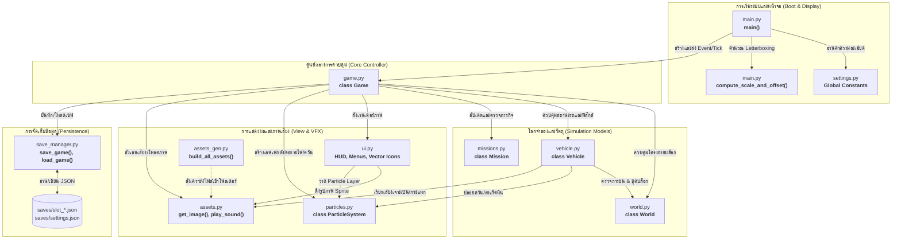
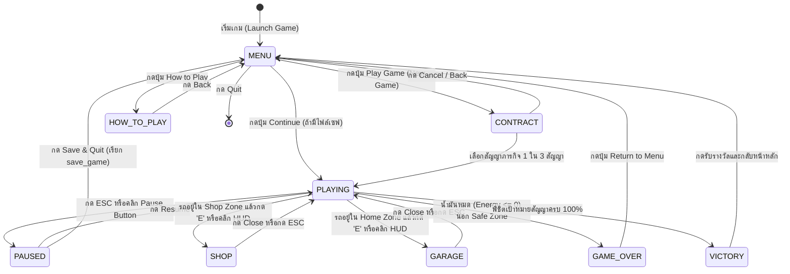
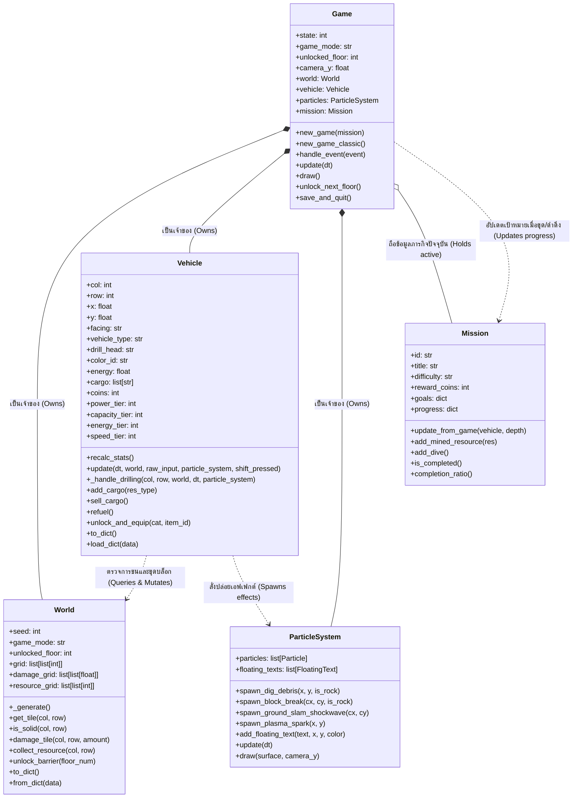
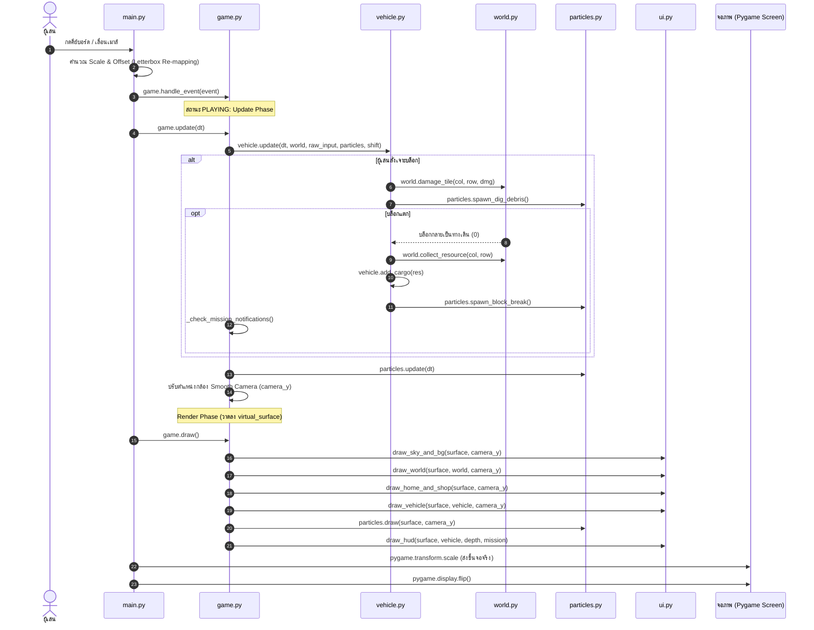

# 🗺️ แผนผังและคู่มือโครงสร้างสถาปัตยกรรมโค้ด (Dig & Treasure Complete Architecture Graph)

เอกสารฉบับนี้จัดทำขึ้นเพื่อให้ผู้อ่านสามารถทำความเข้าใจภาพรวมของโค้ด **ทุกไฟล์ (Files), ทุกฟีเจอร์ (Features), ทุกคลาส (Classes), และทุกฟังก์ชัน (Functions)** ในโปรเจกต์ **Dig & Treasure** ว่ามีความสัมพันธ์ การส่งผ่านข้อมูล และการเชื่อมต่อกันอย่างไร

---

## 📑 สารบัญ
1. [ภาพรวมสถาปัตยกรรมระดับสูง (System Architecture Flowchart)](#1-ภาพรวมสถาปัตยกรรมระดับสูง-system-architecture-flowchart)
2. [แผนผังเครื่องสถานะเกม (Game State Machine Diagram)](#2-แผนผังเครื่องสถานะเกม-game-state-machine-diagram)
3. [แผนผังคลาสและความสัมพันธ์เชิงโครงสร้าง (Class Diagram & Data Ownership)](#3-แผนผังคลาสและความสัมพันธ์เชิงโครงสร้าง-class-diagram--data-ownership)
4. [วงจรการทำงานหลักของเกม (Game Loop & Frame Processing Sequence)](#4-วงจรการทำงานหลักของเกม-game-loop--frame-processing-sequence)
5. [ฟิสิกส์การขุดและการเก็บทรัพยากร (Mining & Physics Flow)](#5-ฟิสิกส์การขุดและการเก็บทรัพยากร-mining--physics-flow)
6. [เจาะลึกทุกไฟล์และทุกฟังก์ชัน (Module & Function Deep-Dive)](#6-เจาะลึกทุกไฟล์และทุกฟังก์ชัน-module--function-deep-dive)
7. [ตารางสรุปปฏิสัมพันธ์ข้ามไฟล์ (Cross-Module Interaction Matrix)](#7-ตารางสรุปปฏิสัมพันธ์ข้ามไฟล์-cross-module-interaction-matrix)

---

## 1. ภาพรวมสถาปัตยกรรมระดับสูง (System Architecture Flowchart)

แผนผังแสดงความสัมพันธ์ระหว่างโมดูลทั้งหมด โดยมี [`main.py`](file:///C:/Users/hp/Desktop/Term%20Project/MidtermProject/main.py) เป็นจุดเริ่มต้นส่งต่อไปยัง [`game.py`](file:///C:/Users/hp/Desktop/Term%20Project/MidtermProject/game.py) ซึ่งทำหน้าที่เป็นศูนย์กลางควบคุมโมดูลย่อยทั้งหมด



---

## 2. แผนผังเครื่องสถานะเกม (Game State Machine Diagram)

เกมทำงานด้วย Finite State Machine 9 สถานะ ซึ่งประกาศไว้ใน [`game.py`](file:///C:/Users/hp/Desktop/Term%20Project/MidtermProject/game.py):



---

## 3. แผนผังคลาสและความสัมพันธ์เชิงโครงสร้าง (Class Diagram & Data Ownership)



---

## 4. วงจรการทำงานหลักของเกม (Game Loop & Frame Processing Sequence)



---

## 5. ฟิสิกส์การขุดและการเก็บทรัพยากร (Mining & Physics Flow)

```mermaid
flowchart TD
    StartInput["รับ Input ทิศทาง (W/A/S/D)"] --> CheckDirection{"ทิศทางเคลื่อนที่?"}
    
    CheckDirection -->|ขึ้น/ลง/ซ้าย/ขวา| AlignAxis["คำนวณ Auto-Centering<br/>ดึงตำแหน่งแกนตรงข้ามเข้าสู่กึ่งกลางช่อง (Tile Center)"]
    
    AlignAxis --> CheckTarget{"ช่องเป้าหมายด้านหน้า<br/>เป็นบล็อกแข็งหรือไม่?"}
    
    CheckTarget -->|ไม่ใช่ (อุโมงค์ว่าง)| MoveNormal["เคลื่อนที่ด้วยความเร็ว speed_pps<br/>ลด Energy ปกติ"]
    
    CheckTarget -->|เป็นบล็อกแข็ง| CheckRock{"เป็นหินแข็ง (Rock) หรือไม่?"}
    
    CheckRock -->|เป็นหิน แต่ Drill Level ต่ำไป| BlockBounce["ขุดไม่เข้า!<br/>เล่นเสียง Rock Clink<br/>เด้งตัวรถกลับ"]
    
    CheckRock -->|ขุดได้| ApplyDamage["คำนวณ Drill DPS (ขึ้นกับ Power Tier)<br/>หักล้าง HP ของบล็อก (Grass 4.0, Dirt 4.5, Rock 18.0)"]
    
    ApplyDamage --> SpawnDebris["สร้างสะเก็ดดิน/หิน (Particle Debris)<br/>เล่นเสียงเจาะวนซ้ำ (Drill Sound Cooldown)"]
    
    SpawnDebris --> CheckBroken{"HP ของบล็อก<br/>ลดลงเหลือ 0 หรือไม่?"}
    
    CheckBroken -->|ยังไม่พัง| ShowCracks["แสดงภาพรอยแตก (Crack Stage 1-3)<br/>ตาม damage_ratio"]
    
    CheckBroken -->|พังทลาย!| TileCleared["บล็อกกลายเป็น 0 (ทางเดิน)<br/>สร้างเอฟเฟกต์ Block Break<br/>สั่นสะเทือน (Screen Shake)"]
    
    TileCleared --> CollectRes{"มีแร่ในช่องหรือไม่?"}
    
    CollectRes -->|มีแร่| CheckCargo{"ความจุ Cargo เต็มหรือไม่?"}
    CheckCargo -->|ยังไม่เต็ม| CargoAdd["นำแร่เข้ากระเป๋า<br/>แสดง Floating Text (+Coin / +Gold / +Diamond)<br/>เล่นเสียง Coin/Gem"]
    CheckCargo -->|เต็มแล้ว!| CargoDrop["แสดงข้อความเตือน 'Cargo Full!'<br/>แร่หล่นสูญหายหรือเก็บไม่ได้"]
    
    CollectRes -->|ไม่มีแร่| EndCycle["เสร็จสิ้นรอบการขุด"]
    CargoAdd --> EndCycle
    CargoDrop --> EndCycle
    ShowCracks --> EndCycle
    MoveNormal --> EndCycle
    BlockBounce --> EndCycle
```

---

## 6. เจาะลึกทุกไฟล์และทุกฟังก์ชัน (Module & Function Deep-Dive)

### 6.1 `main.py`
ไฟล์ Entry point หลักสำหรับรันเกม ดูแลเรื่อง Resolution Independent Scaling และการ Loop

| ชื่อฟังก์ชัน / ฟีเจอร์ | หน้าที่และการทำงาน | ความสัมพันธ์กับโมดูลอื่น |
| :--- | :--- | :--- |
| [`compute_scale_and_offset(win_w, win_h)`](file:///C:/Users/hp/Desktop/Term%20Project/MidtermProject/main.py#L14-L24) | คำนวณอัตราส่วนย่อขยายและขอบดำ (Letterbox/Pillarbox) เพื่อให้เกมแสดงผลบนทุกหน้าจอโดยอัตราส่วน 4:3 (800x600) ไม่บิดเบี้ยว | นำไปใช้ใน Main Loop สำหรับ Re-mapping พิกัดเมาส์ |
| [`main()`](file:///C:/Users/hp/Desktop/Term%20Project/MidtermProject/main.py#L26-L84) | เริ่มต้น Pygame, สร้าง `virtual_surface` (800x600), รัน `Clock(60 FPS)`, จัดการปุ่ม `F11` (Fullscreen) และส่ง Event ให้ Game | เรียก [`Game`](file:///C:/Users/hp/Desktop/Term%20Project/MidtermProject/game.py), [`assets.init()`](file:///C:/Users/hp/Desktop/Term%20Project/MidtermProject/assets.py), และ [`ui.init_fonts()`](file:///C:/Users/hp/Desktop/Term%20Project/MidtermProject/ui.py) |

---

### 6.2 `game.py`
สมองส่วนกลางของระบบ (Central Controller & State Machine) ควบคุมทุกอย่างในเกม

| ชื่อคลาส / เมธอด | หน้าที่และการทำงาน | ความสัมพันธ์กับโมดูลอื่น |
| :--- | :--- | :--- |
| [`class Game`](file:///C:/Users/hp/Desktop/Term%20Project/MidtermProject/game.py#L38-L450) | ออบเจกต์เกมหลัก ถือ State ทั้งหมด และประสานงานระหว่าง World, Vehicle, UI, Particles | ครอบครอง World, Vehicle, ParticleSystem, Mission |
| [`new_game(mission)`](file:///C:/Users/hp/Desktop/Term%20Project/MidtermProject/game.py#L65-L84) | รีเซ็ตและเริ่มเกมโหมด Contract ตามสัญญาที่เลือก | สร้าง instance ใหม่ของ World และ Vehicle |
| [`new_game_classic()`](file:///C:/Users/hp/Desktop/Term%20Project/MidtermProject/game.py#L86-L105) | รีเซ็ตและเริ่มเกมโหมด Classic Endless ไม่จำกัดความลึก | สร้าง World โหมด Endless |
| [`unlock_next_floor()`](file:///C:/Users/hp/Desktop/Term%20Project/MidtermProject/game.py#L107-L126) | ตรวจสอบเงินของผู้เล่นและปลดล็อกประตูกั้นชั้นความลึก | เรียก [`world.unlock_barrier()`](file:///C:/Users/hp/Desktop/Term%20Project/MidtermProject/world.py) |
| [`get_barrier_near_vehicle()`](file:///C:/Users/hp/Desktop/Term%20Project/MidtermProject/game.py#L128-L140) | ตรวจสอบว่ารถอยู่ใกล้ประตูกั้นชั้นหรือไม่ เพื่อแสดง Banner ปลดล็อก | ตรวจสอบพิกัดของ Vehicle กับ Gate Position ใน World |
| [`save_and_quit()`](file:///C:/Users/hp/Desktop/Term%20Project/MidtermProject/game.py#L156-L172) | ดึงข้อมูล World, Vehicle, Game State แล้วบันทึกลง JSON | เรียก [`save_manager.save_game()`](file:///C:/Users/hp/Desktop/Term%20Project/MidtermProject/save_manager.py) |
| [`load_game()`](file:///C:/Users/hp/Desktop/Term%20Project/MidtermProject/game.py#L142-L154) | โหลดข้อมูลจาก JSON กลับมาสร้างออบเจกต์เพื่อเล่นต่อ | เรียก [`save_manager.load_game()`](file:///C:/Users/hp/Desktop/Term%20Project/MidtermProject/save_manager.py) |
| [`update(dt)`](file:///C:/Users/hp/Desktop/Term%20Project/MidtermProject/game.py#L225-L330) | อัปเดตฟิสิกส์รถ, กล้องตามตัวรถ, ตรวจเงื่อนไขน้ำมันหมด, ชนะ/แพ้ | เรียก `vehicle.update()`, `particles.update()` |
| [`draw()`](file:///C:/Users/hp/Desktop/Term%20Project/MidtermProject/game.py#L332-L450) | วาดทุกเลเยอร์ของเกมตาม State ปัจจุบัน | เรียกฟังก์ชันวาดทั้งหมดใน [`ui.py`](file:///C:/Users/hp/Desktop/Term%20Project/MidtermProject/ui.py) |

---

### 6.3 `world.py`
จัดการตารางแผนที่ 2D Grid, การสุ่มสร้างด่าน (Procedural Generation) และบล็อกแร่

| ชื่อคลาส / เมธอด | หน้าที่และการทำงาน | ความสัมพันธ์กับโมดูลอื่น |
| :--- | :--- | :--- |
| [`class World`](file:///C:/Users/hp/Desktop/Term%20Project/MidtermProject/world.py#L10-L195) | เก็บ Grid บล็อก (grid), Grid ความเสียหาย (damage_grid), และ Grid แร่ (resource_grid) | ใช้งานโดย Game และ Vehicle |
| [`_generate()`](file:///C:/Users/hp/Desktop/Term%20Project/MidtermProject/world.py#L24-L60) | สร้างบล็อกตามระดับความลึก: ชั้นหญ้า (Row 4), ชั้นดิน (Row 5+), และสุ่มแทรกหินแข็ง (Rock) | อ่านค่าจาก [`settings.py`](file:///C:/Users/hp/Desktop/Term%20Project/MidtermProject/settings.py) |
| [`_apply_floor_barriers()`](file:///C:/Users/hp/Desktop/Term%20Project/MidtermProject/world.py#L62-L78) | วางบล็อกประตูกั้นชั้น (Barrier) ตามความลึกชั้นที่ยังไม่ปลดล็อก | อิงระดับความลึกของ Floor System |
| [`unlock_barrier(floor_num)`](file:///C:/Users/hp/Desktop/Term%20Project/MidtermProject/world.py#L80-L92) | เปิดประตูกั้นชั้น แปลงบล็อก Barrier เป็นช่องว่างให้อนุญาตให้ขุดลงไปต่อ | อัปเดต grid ให้ทะลุได้ |
| [`damage_tile(col, row, amt)`](file:///C:/Users/hp/Desktop/Term%20Project/MidtermProject/world.py#L125-L148) | เพิ่มความเสียหายให้บล็อก หาก damage >= hardness บล็อกจะแตกเป็นช่องว่าง (0) | ถูกเรียกโดย `vehicle._handle_drilling()` |
| [`collect_resource(col, row)`](file:///C:/Users/hp/Desktop/Term%20Project/MidtermProject/world.py#L150-L162) | ดึงไอเทมแร่ออกจากตารางแล้วเคลียร์เป็นว่างเปล่า | ถูกเรียกเมื่อบล็อกแตก |
| [`to_dict() / from_dict()`](file:///C:/Users/hp/Desktop/Term%20Project/MidtermProject/world.py#L164-L195) | Serialize และ Deserialize ตารางแมพเป็นข้อมูล JSON สำหรับระบบเซฟ | ใช้งานโดย [`save_manager.py`](file:///C:/Users/hp/Desktop/Term%20Project/MidtermProject/save_manager.py) |

---

### 6.4 `vehicle.py`
หัวใจสำคัญของระบบการเล่น: ฟิสิกส์รถขุด, การอัปเกรด, การแต่งตัวถัง และการขุดเจาะ

| ชื่อคลาส / เมธอด | หน้าที่และการทำงาน | ความสัมพันธ์กับโมดูลอื่น |
| :--- | :--- | :--- |
| [`class Vehicle`](file:///C:/Users/hp/Desktop/Term%20Project/MidtermProject/vehicle.py#L11-L470) | ตัวแปรสถานะทั้งหมดของรถ (HP, Energy, Cargo, Tier อัปเกรด, Chassis, Drill Head) | ผูกกับ World, Particles, Assets |
| [`recalc_stats()`](file:///C:/Users/hp/Desktop/Term%20Project/MidtermProject/vehicle.py#L80-L115) | คำนวณค่าพลังงานสูงสุด, ความเร็ว, กำลังเจาะ, ความจุกระเป๋า โดยรวมโบนัสจาก Chassis Type | ดึงสเตตัสจาก Tier และ Vehicle Types |
| [`update(dt, world, input...)`](file:///C:/Users/hp/Desktop/Term%20Project/MidtermProject/vehicle.py#L180-L290) | ประมวลผลการเคลื่อนที่, Gravity, Auto-Centering, Turbo Boost, และตรวจจับการขุด | ประสานงานกับ World และ ParticleSystem |
| [`_handle_drilling(...)`](file:///C:/Users/hp/Desktop/Term%20Project/MidtermProject/vehicle.py#L292-L365) | คำนวณ Drill DPS และหักล้าง HP ของบล็อก พร้อมความสามารถพิเศษของหัวสว่าน (AoE Seismic / Plasma) | เรียก `world.damage_tile()` และสร้างสะเก็ดดิน |
| [`_on_block_dug(...)`](file:///C:/Users/hp/Desktop/Term%20Project/MidtermProject/vehicle.py#L367-L415) | ทำงานเมื่อบล็อกแตก: ดูดแร่เข้า Cargo, เล่นเสียง, สร้างเอฟเฟกต์ระเบิดหิน | เรียก `world.collect_resource()`, `missions.add_mined_resource()` |
| [`add_cargo(res_type)`](file:///C:/Users/hp/Desktop/Term%20Project/MidtermProject/vehicle.py#L135-L145) | เก็บแร่เข้ากระเป๋าหากยังมีที่ว่าง | ส่งผลต่อ Cargo HUD |
| [`sell_cargo()`](file:///C:/Users/hp/Desktop/Term%20Project/MidtermProject/vehicle.py#L147-L162) | ขายแร่ทั้งหมดในกระเป๋า เปลี่ยนเป็นเหรียญ (Coins) | ถูกเรียกเมื่อเข้าร้านค้า (Shop) |
| [`refuel()`](file:///C:/Users/hp/Desktop/Term%20Project/MidtermProject/vehicle.py#L164-L172) | เติมพลังงานเต็ม 100% โดยคำนวณหักเงินตามจำนวนที่เติม | ถูกเรียกเมื่อเข้าร้านค้า (Shop) หรือบ้าน |
| [`do_upgrade(key)`](file:///C:/Users/hp/Desktop/Term%20Project/MidtermProject/vehicle.py#L174-L188) | อัปเกรดสเตตัส (Power, Capacity, Energy, Speed) และหักเงิน | เรียก `recalc_stats()` อัตโนมัติ |
| [`unlock_and_equip(cat, id)`](file:///C:/Users/hp/Desktop/Term%20Project/MidtermProject/vehicle.py#L50-L75) | ปลดล็อกและสวมใส่ Chassis, Drill Head หรือสีใหม่ใน Garage | เปลี่ยน Sprite และ Passive Ability |

---

### 6.5 `ui.py`
โมดูลสำหรับจัดการอินเทอร์เฟซผู้ใช้, การวาด Vector Icons, HUD 3 โซน และเมนูทั้งหมด

| ฟังก์ชันสำคัญ | หน้าที่และการทำงาน |
| :--- | :--- |
| [`draw_hud(...)`](file:///C:/Users/hp/Desktop/Term%20Project/MidtermProject/ui.py#L350-L420) | วาด HUD ด้านบนแยกเป็น 3 โซน: ซ้าย (Cargo & Energy Bar), กลาง (Coins & Depth), ขวา (Mission Goals & Floor Status) |
| [`draw_shop_menu(...)`](file:///C:/Users/hp/Desktop/Term%20Project/MidtermProject/ui.py#L530-L610) | เมนูร้านค้าอัปเกรด 4 สาย พร้อมแท็บขายแร่และเติมน้ำมัน |
| [`draw_garage_menu(...)`](file:///C:/Users/hp/Desktop/Term%20Project/MidtermProject/ui.py#L630-L720) | เมนูอู่ปรับแต่งรถ: เลือกประเภทตัวถัง (4 แบบ), สว่านพิเศษ (5 แบบ), และพาเลทสี (8 สี) |
| [`draw_contract_menu(...)`](file:///C:/Users/hp/Desktop/Term%20Project/MidtermProject/ui.py#L480-L530) | หน้าต่างเลือกสัญญาภารกิจ 3 ตัวเลือกก่อนเริ่มเกม |
| [`draw_world(...)`](file:///C:/Users/hp/Desktop/Term%20Project/MidtermProject/ui.py#L220-L280) | วาดบล็อกดิน/หิน/แร่ พร้อม Viewport Culling วาดเฉพาะแถวที่กล้องมองเห็น |
| `draw_icon_*` (20+ functions) | สังเคราะห์ Vector Icons ด้วยฟังก์ชันคณิตศาสตร์ (เรขาคณิต) โดยไม่ต้องพึ่ง Emoji |

---

### 6.6 `particles.py`
ระบบจัดการเอฟเฟกต์อนุภาค (Particle & VFX System)

| คลาส / เมธอด | หน้าที่และการทำงาน |
| :--- | :--- |
| [`class ParticleSystem`](file:///C:/Users/hp/Desktop/Term%20Project/MidtermProject/particles.py#L32-L170) | จัดการลิสต์ของอนุภาคและข้อความลอย (Floating Texts) ทั้งหมดในเกม |
| `spawn_dig_debris(x, y)` | สร้างเศษดินกระเด็นขณะสว่านกำลังเจาะบล็อก |
| `spawn_block_break(cx, cy)` | ระเบิดอนุภาคกระจายรอบทิศทางเมื่อบล็อกแตกออก |
| `spawn_ground_slam_shockwave()` | สร้างคลื่นกระแทกวงแหวน (Shockwave Ring) เมื่อใช้ Gravity Slam |
| `spawn_plasma_spark()` | ประกายไฟไฟฟ้าสีส้ม/ม่วงสำหรับหัวเจาะ Plasma |
| `add_floating_text(txt, x, y)` | สร้างตัวหนังสือลอยขึ้นพร้อม Fade out (เช่น `+25G`, `Full!`) |

---

### 6.7 `missions.py`
ระบบสุ่มสร้างสัญญาภารกิจและการประเมินความสำเร็จ

| คลาส / ฟังก์ชัน | หน้าที่และการทำงาน |
| :--- | :--- |
| [`class Mission`](file:///C:/Users/hp/Desktop/Term%20Project/MidtermProject/missions.py#L18-L85) | โครงสร้างข้อมูลสัญญาภารกิจ บันทึกเป้าหมาย (ความลึก, จำนวนเหรียญ, ชนิดแร่ที่ต้องขุด) |
| `get_random_mission(diff)` | สุ่มสร้างสัญญาตามระดับความยาก (Easy, Medium, Hard, Epic) |
| `get_three_contract_options()` | สุ่ม 3 สัญญาที่มีความหลากหลายมาให้ผู้เล่นเลือกในหน้า Contract Menu |
| `is_completed()` | คืนค่า `True` เมื่อเป้าหมายทุกข้อในสัญญาสำเร็จครบ 100% นำไปสู่หน้าต่าง VICTORY |

---

### 6.8 `assets.py` & `assets_gen.py`
ระบบการจัดการไฟล์ภาพ เสียง และการสังเคราะห์ Asset

- **[`assets.py`](file:///C:/Users/hp/Desktop/Term%20Project/MidtermProject/assets.py)**: โหลดรูปภาพและเสียงเก็บไว้ในแคช (`_image_cache`, `_sound_cache`) พร้อมระบบ **Audio Cooldown** ป้องกันเสียงเจาะหรือเสียงเครื่องยนต์เล่นซ้อนกันถี่จนเสียงแตกพร่า และรองรับการสลับเปิด/ปิดเสียง (`toggle_mute()`)
- **[`assets_gen.py`](file:///C:/Users/hp/Desktop/Term%20Project/MidtermProject/assets_gen.py)**: สคริปต์สแตนด์อโลนที่เขียนด้วย Pillow และคณิตศาสตร์คลื่นเสียง (Wave synthesis) สามารถสร้างไฟล์สไปรต์ PNG ทั้งหมด 71 ไฟล์ และไฟล์เสียงเอฟเฟกต์ WAV ทั้งหมด 12 ไฟล์ได้เอง 100% โดยไม่ต้องพึ่งพาไฟล์กราฟิกจากภายนอก

---

### 6.9 `save_manager.py`
การบันทึกสถานะลงไฟล์ถาวร (Save & Load Persistence)

| ฟังก์ชัน | หน้าที่และการทำงาน |
| :--- | :--- |
| [`save_game(world, vehicle...)`](file:///C:/Users/hp/Desktop/Term%20Project/MidtermProject/save_manager.py#L12-L35) | รวบรวมข้อมูลสถานะเกม รถ แผนที่ และสถิติ แปลงเป็น JSON บันทึกลง `saves/slot_1.json` |
| [`load_game()`](file:///C:/Users/hp/Desktop/Term%20Project/MidtermProject/save_manager.py#L37-L50) | อ่านไฟล์ JSON และแปลงกลับเป็นโครงสร้างข้อมูลสำหรับเล่นต่อ |
| [`save_exists()`](file:///C:/Users/hp/Desktop/Term%20Project/MidtermProject/save_manager.py#L7-L10) | เช็กว่ามีไฟล์เซฟอยู่หรือไม่ เพื่อเปิดใช้งานปุ่ม "Continue" ในหน้าแรก |

---

### 6.10 `settings.py` & `test_game.py`
- **[`settings.py`](file:///C:/Users/hp/Desktop/Term%20Project/MidtermProject/settings.py)**: คลังค่าคงที่ของทั้งเกม เช่น ขนาดหน้าจอ (800x600), ขนาดบล็อก (32x32 พิกเซล), อัตราแลกเปลี่ยนแร่, ความแข็งบล็อก (Grass 4.0, Dirt 4.5, Rock 18.0), ค่าใช้จ่ายอัปเกรด, และข้อมูลความลึกของชั้น (Floors 1-4)
- **[`test_game.py`](file:///C:/Users/hp/Desktop/Term%20Project/MidtermProject/test_game.py)**: ชุด Automated Unit & Integration Tests แบบ Headless (รันได้โดยไม่ต้องเปิดหน้าต่าง GUI) ครอบคลุมการทดสอบกลไกการขุด, การหักล้างพลังงาน, การอัปเกรดสเตตัส, การเซฟและโหลดเกม 100% Pass

---

## 7. ตารางสรุปปฏิสัมพันธ์ข้ามไฟล์ (Cross-Module Interaction Matrix)

ตารางแสดงว่าไฟล์ใดเรียกใช้ (Calls/Imports) ไฟล์ใดบ้างในระบบ:

| ไฟล์ต้นทาง (Caller) | เรียกใช้ไฟล์ปลายทาง (Callee) | วัตถุประสงค์ของการเชื่อมต่อ |
| :--- | :--- | :--- |
| **`main.py`** | `game.py` | สร้างและส่ง Event / Update / Render ลูปหลัก |
| **`main.py`** | `settings.py` | ดึงค่าความละเอียดหน้าจอ (800x600) |
| **`main.py`** | `assets.py`, `ui.py` | เรียก `init()` โหลดทรัพยากรและฟอนต์ |
| **`game.py`** | `world.py` | สร้าง ควบคุม และเซฟสถานะบล็อกในโลก |
| **`game.py`** | `vehicle.py` | ควบคุมฟิสิกส์ การขุด และการเคลื่อนที่ของตัวละคร |
| **`game.py`** | `missions.py` | ตรวจสอบและอัปเดตความคืบหน้าของสัญญาภารกิจ |
| **`game.py`** | `particles.py` | สั่งให้ ParticleSystem ทำงานและเรนเดอร์ |
| **`game.py`** | `ui.py` | เรียกฟังก์ชันวาด HUD และเมนูทั้งหมด |
| **`game.py`** | `save_manager.py` | อ่านและเขียนสถานะเกมลงไฟล์ JSON |
| **`game.py`** | `assets.py` | เล่นเพลง/เสียงประกอบตาม State |
| **`vehicle.py`** | `world.py` | ตรวจการชน (is_solid), สั่งทำลายบล็อก (damage_tile) |
| **`vehicle.py`** | `particles.py` | ปล่อยควัน (Exhaust), ปล่อยสะเก็ดหิน (Sparks) |
| **`vehicle.py`** | `assets.py` | สั่งเล่นเสียงขุด (drill), เติมน้ำมัน (refuel), เสียงเหรียญ |
| **`ui.py`** | `assets.py` | ดึงรูปภาพ Sprite จาก Cache ผ่าน `get_image()` |
| **`ui.py`** | `missions.py` | ดึงข้อความ format progress ของสัญญามาแสดงบน HUD |
| **`test_game.py`** | `game.py`, `world.py`, `vehicle.py` | จำลองเกมเพื่อรันการทดสอบ Unit Tests |
